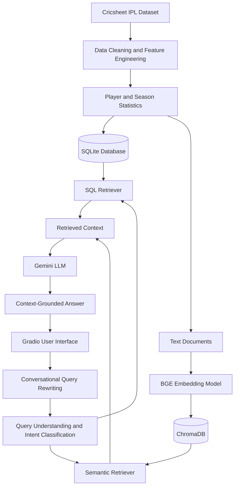

# 🏏 IPL Cricket Intelligence RAG

An AI-powered cricket analytics chatbot that answers natural-language questions about historical Indian Premier League (IPL) statistics using **Hybrid Retrieval-Augmented Generation (RAG)**. It combines structured SQL retrieval with semantic vector search and Google Gemini to generate context-grounded answers through an interactive Gradio interface.

## Features

- Player-wise and season-wise batting and bowling statistics
- SQL retrieval for numerical cricket statistics
- Semantic search using BGE embeddings and ChromaDB
- Metadata filtering by player, season and document type
- Rule-based query understanding and intent classification
- Hybrid retrieval combining structured statistics and textual context
- Gemini-based answer generation with model fallback
- Conversational memory for follow-up questions through query rewriting
- Interactive Gradio chatbot with retrieval mode, model name and response time
- Initial RAG evaluation and database backup to Google Drive

## System Architecture



The query router selects SQL, vector search, or both depending on the question. The generation prompt prioritizes SQL statistics for numerical answers and instructs the model not to invent missing information.

## Technology Stack

| Component | Technology |
|---|---|
| Programming language | Python |
| Development environment | Google Colab, Jupyter Notebook |
| Data processing | Pandas, NumPy |
| Structured database | SQLite |
| Embedding model | `BAAI/bge-base-en-v1.5` |
| Embedding library | Sentence Transformers |
| Vector database | ChromaDB |
| Large language model | Google Gemini (`google-genai`) |
| User interface | Gradio |
| Database backup | Google Drive |

## Dataset

**Source:** [Cricsheet — IPL ball-by-ball data](https://cricsheet.org/downloads/)

The project uses the IPL men's CSV2 dataset (`ipl_male_csv2.zip`), specifically `all_matches.csv`. The data contains delivery-level information including batting and bowling teams, players, runs, extras, dismissals, venues and seasons.

The preprocessing pipeline handles missing values, converts data types and derives batting and bowling statistics. The saved notebook records **5,162 indexed batting and bowling documents** in ChromaDB.

Download the dataset from the original provider and review its license before redistributing it. Statistics reflect the downloaded dataset snapshot, not live IPL results.

## Retrieval Strategy

| Mode | Purpose | Example |
|---|---|---|
| SQL | Retrieve structured numerical statistics | How many runs did Kohli score in IPL 2022? |
| Vector | Retrieve relevant textual context | Explain Kohli batting performance in 2022. |
| Hybrid | Combine statistics and semantic context | Explain Bumrah bowling performance and total wickets in 2022. |

SQLite stores four statistics tables: `batting_stats`, `bowling_stats`, `season_batting` and `season_bowling`.

## Getting Started

### 1. Download the notebook

Clone or download this repository and open `IPL_Cricket_Intelligence.ipynb` in [Google Colab](https://colab.research.google.com/). Rename the notebook if necessary to match this filename.

### 2. Install dependencies

Run the installation cells in the notebook, or install the following packages in Colab:

```python
!pip install -q pandas numpy sentence-transformers chromadb google-genai gradio
```

### 3. Configure the Gemini API key

Create an API key in [Google AI Studio](https://aistudio.google.com/apikey). In Colab, open the Secrets panel, create a secret named `IPLKEY`, and enable notebook access.

Never commit API keys or credentials to GitHub. The configured Gemini models must be available to your API account; update the fallback list if necessary.

### 4. Prepare the dataset

Upload `ipl_male_csv2.zip` to Google Drive. The notebook expects:

```text
MyDrive/Colab_Notebooks/genai/datasets/ipl_male_csv2.zip
```

Alternatively, update `zip_path` in the notebook to match your dataset location.

### 5. Run the pipeline

Run the notebook in order to preprocess the data, create SQLite statistics, generate embeddings, populate ChromaDB, initialize Gemini and launch the Gradio interface. The notebook includes a database backup step and reconnects to the local runtime databases before launching Gradio.

For later sessions, restore the saved database files from Google Drive before connecting to them, load the same embedding model and run the RAG function definitions and Gradio cell. Regenerating the dataset and document embeddings is unnecessary when compatible backups are available.

## Example Questions

- How many runs did Kohli score in IPL 2022?
- How many wickets did Bumrah take in IPL 2022?
- Who scored the most runs in IPL 2024?
- Explain Kohli batting performance in 2024.
- What about his strike rate? (follow-up in the same conversation)

## Initial Evaluation

The saved notebook reports the following results from a five-question evaluation covering SQL, vector and hybrid retrieval:

| Metric | Recorded result |
|---|---:|
| Test questions | 5 |
| Answer keyword match | 100% |
| Context keyword match | 100% |
| Intent classification accuracy | 100% |
| API success rate | 100% |
| Average response time | 4.08 seconds |

These are results of a small, notebook-recorded test using expected keyword matching. They are not evidence of 100% accuracy on arbitrary questions or a comprehensive faithfulness benchmark. Latency and API availability may vary.


## Author

**Krishnakanth R**

## Acknowledgements

- Cricsheet — IPL ball-by-ball dataset
- BAAI and Sentence Transformers — text embeddings
- ChromaDB and SQLite — retrieval storage
- Google Gemini — answer generation
- Gradio — chatbot interface
